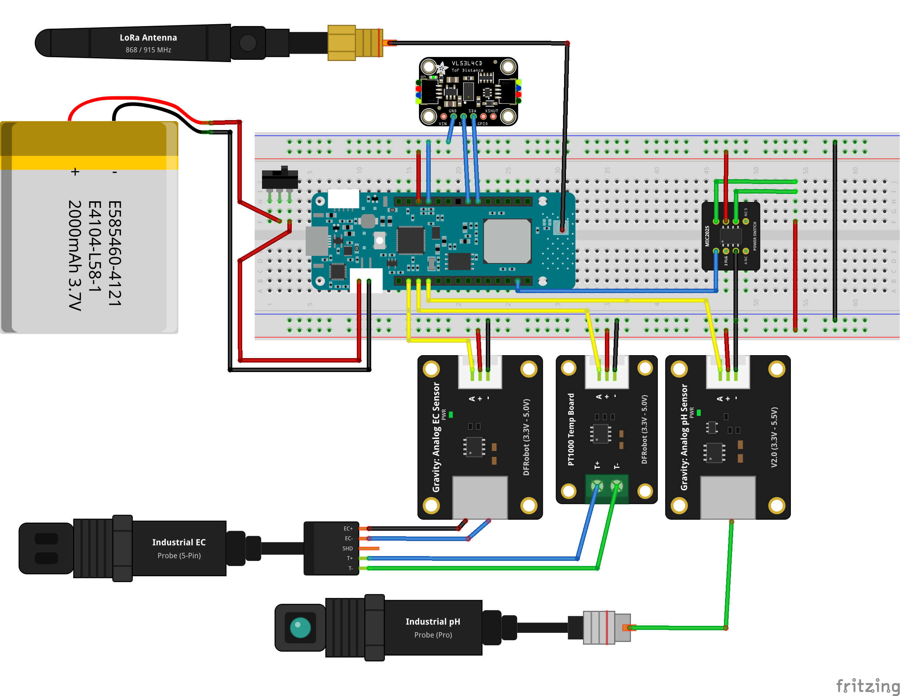

# Arduino irrigation water analysis system using LoRaWan 
#
*Schematics, measurement part\
\
*Schematics, tank emptying part\
\
* Under construction!!!
\

* Irrigation water analysis equipment passing through the growing medium. Vertical farming.

## 🚀 Architecture

### End Node (Arduino MKR) --(LoRa 868MHz)--> Gateway (Dragino) --> ChirpStack --> Backend (InfluxDB)

## 📁 Repository structure 
* `/firmware` - Arduino C++ code (transmitter side) and water drain valve control
* `/gateway` - Instructions and settings for configuring the Dragino gateway
* `/backend` - InfluxDB database installation instructions and data ingestion scripts
* `/hardware` - Wiring diagrams, Bill of Materials (BOM), and optional 3D printing files

## 🛠️ Hardware and Components
* **Microcontroller:** Arduino MKR WAN 1310 ja XIAO Esp32-C3
* **LoRa-module:** Murata CMWX1ZZABZ LoRa® module (include MKR 1310, Frequency: 868 MHz EU)
* **Sensors:** DFrobot analog pH sensor pro (SEN0169), DfRobot analog conductivity sensor (SEN0451), Adafruit StemmaQT VL53L4CD Time of Flight -sensor 
* **Gateway:** Dragino LoRaWAN Gateway LPS8V2 *
* **Actuators** Servo- motor
* **Power supplys:**  AKY0393Li-Po -battery 2200mAh (Arduino + sensors), XIAO-ESP32C3, `Servomoottori MG996R`, `IRLU8721-N channel MOSFET`
## 💻 Software requirements
  * Arduino IDE for programming the sensor node and the drain valve
## ⚙️ Getting Started / Setup Instructions
* Use the Hackster.io project page alongside the GitHub repository folders. GitHub hosts the software, while Hackster.io contains all other necessary documentation and materials.
### 1. Hardware and Wiring: 
*  Refer to Hackster.io or the /hardware folder for detailed wiring diagrams and pinouts.
### 2. Node programming (`/firmware`) 
* Arduino MKR1310: Open the `ph_to_lora_github.ino` sketch in in the Arduino IDE.
* Install the required libraries: `Arduino Low Power`, `MKRWAN_V2` and `DFRobot_ECPRO-master`, `Sparkfun_VL53L1X_4m_Laser_Distance_Sensor`,`ESP32Servo`.
* Open `arduino_secrets.h` and enter your LoRaWAN-keys (`AppEUI`, `AppKey` are re-programmed on the MKR1310).
* ESP32-C3: Upload the ` Drain_water_6_Tunti.ino'  
### 3. Dragino & LoRaWAN-server (`/gateway`) 
* Configure the Dragino gateway to use the correct frequency plan (`EU868`, see screenshots for reference).
* Point the gateway to the LoRaWAN server (in this case, the built-in ChirpStack server on the Dragino).
* Copy the contents of `/backend/decoder.js` into the *Payload Formatter* section of the LoRaWAN server to decode byte payloads into JSON format.

### 4. Database (`/backend`) 
* The database is hosted on a Raspberry Pi 5.
* Install InfluxDB according to the provided instructions.
* Start the database service.

## 🔒 Security & Remote access
* If you set up remote access, the connection to the InfluxDB database must be secured. Do not expose database ports directly to the public internet. Recommended methods for remote access:
* Raspberry Pi Connect: Use Raspberry Pi's native remote access tool.
* Tailscale / WireGuard: Create a secure VPN connection between your devices without opening any public ports.
    
     ### 🤝 Contributions, improvement suggestions, and bug reports are welcome!
 

# 
# Arduino kasteluveden analysointijärjestelmä LoRaWan-yhteydellä 
#
*Kytkentäkaavio mittausosasta\
\
*Kytkentäkaavio säiliön tyhjennysosasta\
\
* Under construction!!!
\

* Irrigation water analysis equipment passing through the growing medium. Vertical farming. Kasvien kastelussa kierrätetyn veden analysointijärjestelmä.

* Tämä on avoimen lähdekoodin IoT-projekti, joka mittaa kasvihuoneessa/tunneliviljelyssä linjaston läpi kulkeneen veden määrää, johtavuutta ja pH:ta käyttäen akkukäyttöistä Arduino MKR WAN 1310-solmua. Data lähetetään pitkän kantaman LoRaWAN-verkon ja Dragino-reitittimen kautta etähallittavaan Raspberry Pi:n InfluxDB-aikasarjatietokantaan.

## 🚀 Arkkitehtuuri

### End Node (Arduino MKR) --(LoRa 868MHz)--> Gateway (Dragino) --> ChirpStack --> Backend (InfluxDB)
### Mittaussolmu (Arduino MKR) --> (LoRa 868MHz)--> Gateway (Dragino) --> ChirpStack --> Backend (InfluxDB)

## 📁 Repositorion rakenne 
* `/firmware` - Arduino C++ koodi (lähettävä puoli) sekä veden tyhjennysventtiilin ohjaus
* `/gateway` - Ohjeet ja asetukset Dragino-reitittimen konfigurointiin
* `/backend` - InfluxDB-tietokannan asennusohjeet ja datan vastaanottoskriptit
* `/hardware` - Kytkentäkaaviot, osaluettelo (BOM) ja mahdolliset 3D-tulostustiedostot
## 🛠️ Laitteisto ja komponentit 
* **Mikrokontrolleri:** Arduino MKR WAN 1310 ja XIAO Esp32-C3
* **LoRa-moduuli:** Murata CMWX1ZZABZ LoRa® module (sisältyy MKR 1310, Taajuus: 868 MHz EU)
* **Anturit:** DFrobot analog pH sensor pro (SEN0169), DfRobot analog conductivity sensor (SEN0451), Adafruit StemmaQT VL53L4CD Time of Flight -etäisyysanturi 
* **Gateway:** Dragino LoRaWAN Gateway LPS8V2 *
* **Toimilaite** Servo- moottori 
* **Virtalähde:**  AKY0393Li-Po -akku 2200mAh (Arduino + sensors), ? (XIAO), ? (Servo moottori)
## 💻 Ohjelmistovaatimukset
  * Arduino IDE mittaussolmun ja tyhjennysventtiilin ohjelmointiin 
## ⚙️ Käyttöönotto-ohjeet
* Käytä rinnakkain Hacster.io -sivustoa ja Githubin kansioita. Githubissa ohjelmistot, Hacsterissa muu tarvittava materiaali.
### 1. Laitteisto ja kytkennät: 
* Katso tarkat kytkentäkaaviot ja pinnijärjestykset Hacster.io:sta tai kansiosta `/hardware`.
### 2. Solmun ohjelmointi (`/firmware`) 
* Arduino MKR1310: Avaa koodi Arduino `ph_to_lora_github.ino` IDE:ssä.
* Asenna tarvittavat kirjastot: `Arduino Low Power`, `MKRWAN_V2` ja `DFRobot_ECPRO-master`, `Sparkfun_VL53L1X_4m_Laser_Distance_Sensor`,`ESP32Servo`.
* Avaa tiedosto `arduino_secrets.h` (tai vastaava) ja syötä oma LoRaWAN-avaimesi (`AppEUI`, `AppKey` ovat MKR1310:ssä valmiiksi ohjelmoituna).
* ESP32-C3: Lataa tiedosto ` Drain_water_6_Tunti.ino, IDE:ssä,`Servomoottori MG996R`, `IRLU8721-N channel MOSFET`  
### 3. Dragino & LoRaWAN-palvelin (`/gateway`) 
* Konfiguroi Dragino-reititin käyttämään oikeaa taajuussuunnitelmaa (`EU868`, katso kuvankaappaukset).
* Ohjaa reititin LoRaWAN-palvelimelle (tässä tapauksessa ChirpStack-palvelin Draginon sisällä).
* Lisää `/backend/decoder.js` -tiedoston sisältö LoRaWAN-palvelimen *Payload Formatter* -osioon, jotta tavumuotoinen data muuttuu JSON-muotoon.
### 4. Tietokanta (`/backend`) 
* Tietokantaa ajetaan Raspberry Pi 5:ssä. 
* Asenna Influxdb -tietokanta ohjeiden mukaisesti
* Käynnistä tietokanta
## 🔒 Tietoturva & Etäyhteys
* Jos asennat etäyhteyden, etäyhteys InfluxDB-tietokantaan on suojattava. Älä avaa tietokantaportteja suoraan julkiseen internetiin. Suositellut tavat etäyhteyden muodostamiseen:
*  Käytä RPI omaa etäyhteyttä `Raspberry Pi Connect`
*  Tailscale / WireGuard: voit tehdä suojatun VPN-yhteyden laitteitesi välille ilman avoimia portteja. 
    
    * ### 🤝 Osallistuminen, parannusehdotukset ja virheilmoitukset ovat tervetulleita!

